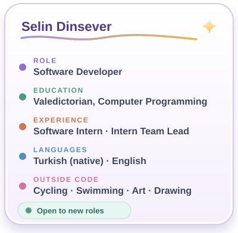
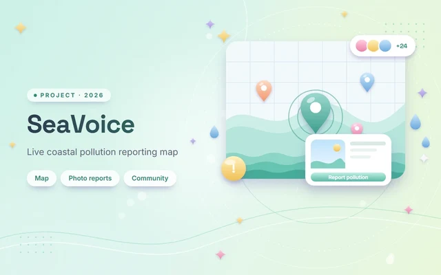
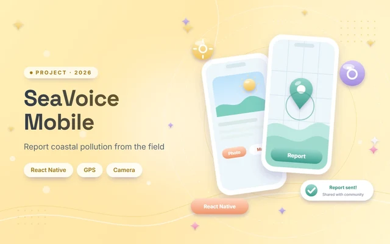
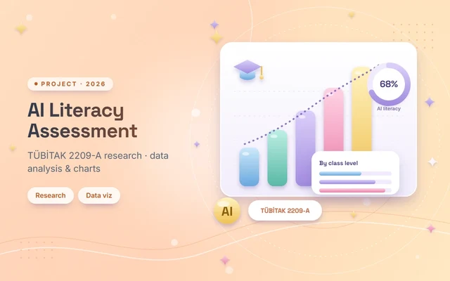
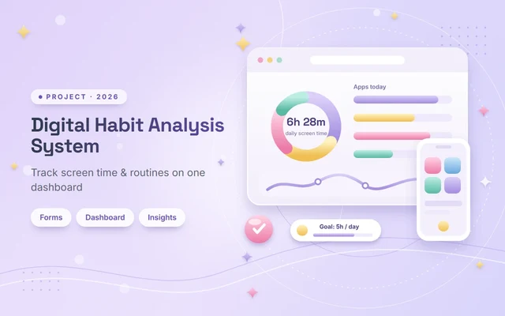
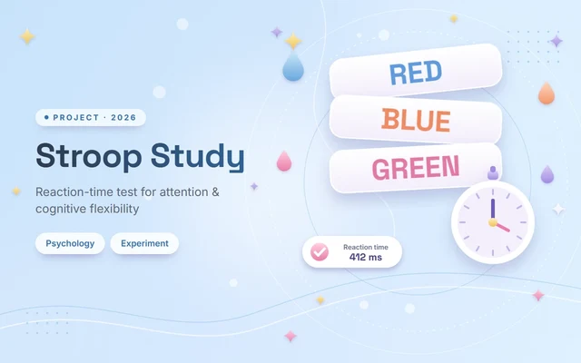
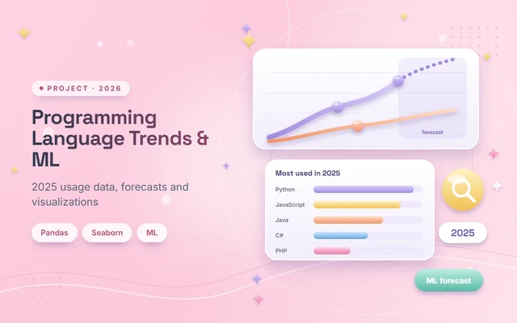
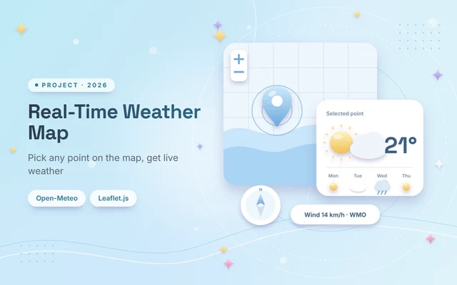
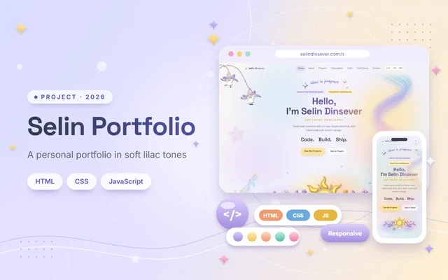

  

 

<table>
<tr>
<td width="58%" valign="top">

I build **backend and full-stack solutions** with Java (Spring Boot) and C# (.NET), and I'm drawn to **AI** and data-driven projects. I care about **clean code** and **user experience**.

I graduated from the **Computer Programming** program at İzmir University of Economics as the **department valedictorian**. At Sisbim Technology I worked as a **Software Intern** and **Intern Team Lead**, taking an active role in backend development, process automation and team coordination.

I develop full-stack solutions with **Java (Spring Boot)**, **C# (.NET)** and **Python (AI/ML)**. As **Project Lead** of our TÜBİTAK 2209-A AI literacy research, I presented our work as an oral paper at **EDUCongress 2026**.

> *I shape my projects around social benefit, data analysis and scientific research.*

</td>
<td width="42%" valign="top" align="center">

</td>
</tr>
</table>

| Institution | Program | Years | Degree |
|:--|:--|:--:|:--:|
| **İzmir University of Economics** | Computer Programming | 2024 – 2026 | Valedictorian |

**Sisbim Technology and Software Inc.** · *Software Intern · Intern Team Lead*

- Developing and managing backend processes with `C#` and `MSSQL`
- Process automation and data processing optimizations
- Task distribution, workflow and coordination of the intern team

**Research** · *Project Lead · TÜBİTAK 2209-A*

- Analysis of the AI literacy levels of computer programming students
- Processing and reporting data with `Python` (`Pandas` `NumPy` `SciPy` `Seaborn`)

**Communities**

| Community | Role |
|:--|:--|
| IUE Gamethon 5.0 | Mentor |
| İzmir Data Community | Member |

<table>
<tr>
<td align="left" width="190"><b>Programming Languages</b></td>
<td align="left">&nbsp;&nbsp;&nbsp;&nbsp;&nbsp;&nbsp;</td>
</tr>
<tr>
<td align="left" width="190"><b>Backend & Frameworks</b></td>
<td align="left">&nbsp;&nbsp;&nbsp;</td>
</tr>
<tr>
<td align="left" width="190"><b>Frontend & Mobile</b></td>
<td align="left">&nbsp;&nbsp;&nbsp;</td>
</tr>
<tr>
<td align="left" width="190"><b>Databases</b></td>
<td align="left">&nbsp;&nbsp;&nbsp;&nbsp;</td>
</tr>
<tr>
<td align="left" width="190"><b>Data Analysis & ML</b></td>
<td align="left">&nbsp;&nbsp;&nbsp;&nbsp;&nbsp;</td>
</tr>
<tr>
<td align="left" width="190"><b>Tools</b></td>
<td align="left">&nbsp;&nbsp;</td>
</tr>
</table>

Hover over an icon to see the technology name

 

<table>
<tr>
<td align="center" width="25%"><b>Problem Solving</b> Analytical thinking</td>
<td align="center" width="25%"><b>Communication</b> Effective decision making</td>
<td align="center" width="25%"><b>Project Management</b> Planning &amp; follow-up</td>
<td align="center" width="25%"><b>Team Leadership</b> Team coordination</td>
</tr>
</table>

<table>
<tr>
<td width="33%" valign="top"> <b>SeaVoice</b> · <a href="https://github.com/selindinsever/Seavoice-Js">Web</a> Coastal pollution reporting on a live map <code>PHP</code> <code>MSSQL</code> <code>Leaflet.js</code></td>
<td width="33%" valign="top"> <b>SeaVoice Mobile</b> · <a href="https://github.com/selindinsever/SeavoiceMobileApp">GitHub</a> Report pollution from the field with GPS and camera <code>React Native</code> <code>TypeScript</code></td>
<td width="33%" valign="top"> <b>AI Literacy Assessment</b> · <a href="https://github.com/selindinsever/Yapay-Zeka-Okuryazarl-g-Duzeyi-Belirleme-Analizi-TUBITAK-2209-A-">GitHub</a> TÜBİTAK 2209-A research on students' AI literacy <code>Python</code> <code>Pandas</code> <code>Seaborn</code></td>
</tr>
<tr>
<td width="33%" valign="top"> <b>Digital Habit Analysis System</b> · <a href="https://github.com/selindinsever/Dijital-Aliskanlik-Analiz-Sistemi">GitHub</a> Screen time and routines on one dashboard <code>Data Visualization</code></td>
<td width="33%" valign="top"> <b>Stroop Study</b> · <a href="https://github.com/selindinsever/stroop-psychology-research">GitHub</a> Reaction-time test for attention and cognitive flexibility <code>Python</code></td>
<td width="33%" valign="top"> <b>Programming Language Trends</b> · <a href="https://github.com/selindinsever/Analysis-of-Programming-Language-Trends">GitHub</a> 2025 language trends with machine learning <code>Python</code> <code>Pandas</code> <code>scikit-learn</code></td>
</tr>
<tr>
<td width="33%" valign="top"> <b>Open-Meteo Weather</b> · <a href="https://github.com/selindinsever/open-meteo-map-js">GitHub</a> Interactive weather map with reverse geocoding <code>JavaScript</code> <code>Open-Meteo API</code></td>
<td width="33%" valign="top"> <b>My LifeActivity Calendar</b> · <a href="https://github.com/selindinsever/ActivityCalendar">GitHub</a> Personal task and event planner</td>
<td width="33%" valign="top"> <b>Selin Portfolio</b> · <a href="https://selindinsever.com.tr">Live site</a> This portfolio, in soft lilac tones <code>HTML</code> <code>CSS</code> <code>JavaScript</code></td>
</tr>
</table>

Also: [**Marine Pollution Monitoring System**](https://github.com/selindinsever/Deniz_Kirliligi_Izleme_Sistemi_MSSQL_Proje_Odevi) · a relational database project for tracking marine pollution data · `MSSQL`

**The Role of Class Level and AI Education in the AI Literacy Levels of Computer Programming Students**
 EDUCongress 2026 · Gaziantep University · Oral Paper · Presented · Included in the Abstract Book

> Analyses show that AI education in the curriculum increased AI literacy scores with a statistically significant and large effect (*d = 0.80, p = 0.004*). The study recommends adding a compulsory **AI Ethics** course and algorithmic foundations to associate degree programs.

<b>2024 – 2026 · 11 certificates · Show all</b>

 

| Certificate | Issuer | Year |
|:--|:--|:--:|
| AI-Assisted Web/Mobile Development Bootcamp with Ruby on Rails and Claude Code | İzmir University of Economics | 2026 |
| Java Masterclass IATELS Certificate | Berk Akademi | 2026 |
| Java Masterclass ICCW Certificate | Berk Akademi | 2026 |
| Software Expertise Certificate | Adıgüzel Vocational School | 2026 |
| Future Dream Project Awareness Programs Participation Certificate | Ford Otosan | 2025 |
| Introduction to Machine Learning Workshop | İzmir University of Economics | 2025 |
| Applied C# Training Course | Udemy · Murat Yücedağ | 2024 – 2025 |
| IUE Gamethon 5.0 Mentorship Title | İzmir University of Economics | 2024 |
| Introduction to Modern AI | Cisco & IUE | 2024 |
| AI: The Technology of the Future | İzmir University of Economics | 2024 |
| Introduction to Data Science | Cisco / BMECO | 2024 |

